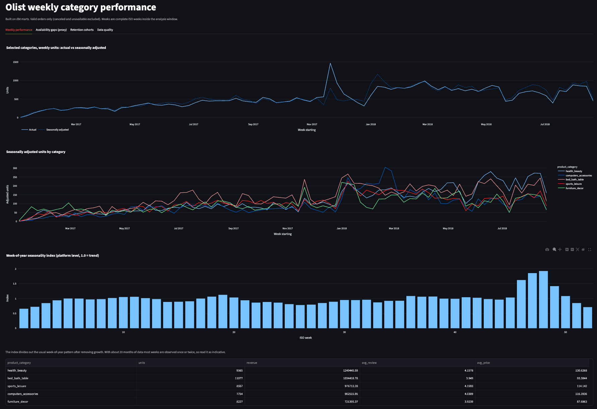
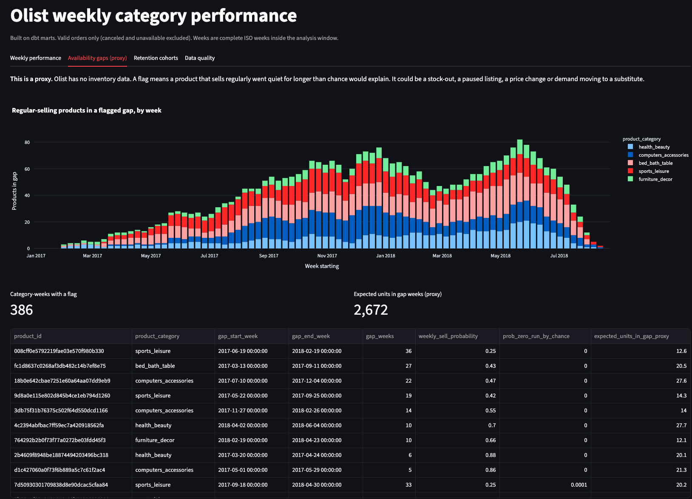

# Olist dbt analytics

A tested, documented metrics layer for a Brazilian e-commerce marketplace, built with
dbt and DuckDB so the whole thing runs on a laptop with no warehouse. It turns about
100k raw Olist orders into weekly product-category performance (with seasonality
adjustment and a flag for likely availability gaps), customer retention cohorts and a
data quality summary, and serves them in a small Streamlit dashboard.

Author: Sherie Lin ([github.com/Pinghsuanlin](https://github.com/Pinghsuanlin))

## Why this project

Most metric arguments are definition arguments. "Revenue" with or without freight,
"customer" as an order id or a person, "repeat rate" for a cohort that has not had
time to come back. This project shows the opposite habit: each metric has one
definition, written once, tested on every build and documented next to the column
it lives in. When the dashboard and an ad hoc query disagree, the answer is in
the code, not in someone's head.

## What it shows

- **dbt modelling layers.** Staging (one model per source, rename, type, dedupe),
  intermediate (reusable building blocks), marts (what people query). 9 staging,
  7 intermediate, 7 mart models and a data quality model.
- **Testing.** Generic tests (`unique`, `not_null`, `relationships`,
  `accepted_values`, `dbt_utils` range and combination tests), a custom generic
  test (`non_negative`), and six singular tests that check business logic: order
  value reconciles to item lines, no negative prices, payments reconcile to order
  value (warning), units survive every aggregation step, retention rates rise with
  the window, the seasonality index is centred on 1.0.
- **Documentation.** Every model and every column has a description. Shared
  definitions (valid order, gross order value, cohort, repeat purchase, the gap
  proxy) are `` blocks reused across models. The dashboard is declared as
  a dbt exposure, so it shows up in the lineage graph.
- **CI.** GitHub Actions builds the full project and runs every test on every push,
  against a synthetic sample generated on the fly, so CI never needs the real data.
- **Seasonality adjustment.** A platform-level week-of-year index, estimated
  against a fitted growth trend so that growth is not mistaken for season.
- **Data quality.** `dq_summary` sizes each known source quirk (orders without
  items, payment mismatches, duplicate reviews, missing translations, and so on)
  so it can be monitored rather than rediscovered.

## Lineage

```
raw.*  9 VARCHAR tables, loaded by scripts/load_raw.py
  |
  v
stg_olist__*  9 views: rename, type, deduplicate
  |
  +--> int_order_reviews -----------+---------------------------+
  |                                 |                           |
  |                                 v                           v
  +--> int_order_items_enriched  (items + orders + customers    fct_orders
  |         |                     + products + translation        |
  |         |                     + sellers + reviews)            v
  |         v                                                   dim_customers
  |    int_product_weekly_sales                                   |
  |         |                                                     v
  |         +--> int_product_sales_profile                      mart_customer_retention
  |         |         |
  |         |         +--> int_product_availability_gaps --+--> mart_product_availability_gaps
  |         |         |                                    |
  |         |         +--> dim_products                    |
  |         |                                              v
  |         +--> int_seasonality_index ---------------> mart_demand_adjusted_weekly (view)
  |         |                                              ^
  |         +--> mart_product_performance_weekly ----------+
  |
  +--> int_week_spine  complete ISO weeks in the analysis window; feeds the sales
                       profile, gap, seasonality and weekly performance models

fct_orders, dim_products, dim_customers, int_order_reviews  -->  dq_summary
marts + dq_summary  -->  dashboard/app.py  (declared as a dbt exposure)
```

Run `make docs-serve` for the interactive version of this graph.

## Design decisions and trade-offs

**DuckDB locally instead of a cloud warehouse.** The dataset is about 1.5M rows in
total, which DuckDB handles in seconds on a laptop. Anyone can clone the repo and
run it with no account, no credentials and no cost, and CI runs the real dbt build
rather than a mock. The trade-off: DuckDB SQL is close to, but not identical to,
BigQuery or Snowflake SQL (`qualify`, `generate_series`, `arg_max`, `filter`
clauses). Moving to a warehouse means a new profile and a handful of syntax edits,
mostly isolated in the macros.

**Loading with a Python script, not dbt seeds or external sources.** Seeds are
meant for small lookup tables and would load 1M geolocation rows slowly. dbt-duckdb
can read CSVs directly as external sources, but then every file quirk (a possible
byte-order mark in a header, multi-line review text) leaks into the models. `load_raw.py`
copies each CSV into a `raw` schema as all-VARCHAR tables, cleans header names, and
falls back to pandas if DuckDB's CSV reader rejects a file. Typing then happens in
exactly one place, the staging models, and a bad value fails the build loudly.

**Strict layering.** Staging only renames, casts and deduplicates. Joins and
business logic start in intermediate. Marts are the only layer the dashboard reads.
Shared rules live in macros (`is_valid_order`, `week_start`,
`product_category_label`, `safe_divide`) and thresholds live in `dbt_project.yml`
vars, so a definition change is a one-line, reviewable diff.

**One definition of each metric.** Order value is item price plus freight, defined
in `fct_orders`; payments are reconciled against it but do not define it (vouchers
and instalment interest make payments noisy). "First order" and "repeat purchase"
are defined once in `dim_customers`; the retention mart only aggregates them.

**Availability gaps are a proxy, and labelled as one everywhere.** Olist publishes
no inventory, listing or stock data, so stock-outs cannot be observed. The model
flags suspicious silence instead. For a product that sells regularly (at least 8
selling weeks, and selling in at least a quarter of the weeks between its first and
last sale), it measures p, the share of weeks with a sale. A run of r empty weeks
would happen by luck with probability (1 - p) ^ r. When the run is at least 3 weeks
and that probability is below 5%, the weeks are flagged. Limits:

- A flag can mean a stock-out, a paused listing, a price change, a seller leaving
  or demand moving to a substitute. It is a prompt to investigate, not a finding.
- p is computed over a span that includes the gap itself, so the test is
  conservative: real gaps lower p and make themselves harder to flag.
- A product gets many chances to show a run over 80 weeks, so a 5% threshold
  per run will produce some false flags. The threshold and minimum run length
  are vars for that reason.
- Most Olist products sell a handful of times in total, so only a small share of
  the catalogue is scored at all.
- `expected_units_in_gap_proxy` (usual weekly units times gap length) is a rough
  size of possibly unserved demand, not a lost-sales estimate.

**Seasonality is estimated at platform level.** The index fits a log-linear growth
trend to total weekly units, takes each week's ratio to trend, averages by ISO week,
smooths with a centred 3-week moving average and rescales to average 1.0. Fitting
the trend first matters: Olist grew quickly through 2017 and 2018, so a raw
week-of-year average would read growth as season. It is platform level rather than
per category because about 20 months of data cannot support 70+ separate seasonal
shapes. The cost: categories with their own pattern are only partly corrected, and
most ISO weeks are observed once or twice, so one-off events are absorbed into the
index.

**Cohort definition.** A customer is a person (`customer_unique_id`), not Olist's
`customer_id`, which changes with every order and would make every customer look
new. The cohort is the month of the first valid order (canceled and unavailable
excluded). A repeat purchase is a later valid order placed at least 1 day after
the first, so same-day split baskets do not count as loyalty. A cohort's 30, 90 or
180-day rate is only reported once every customer in it has had the full window
inside the data; otherwise it is null rather than artificially low.

**Complete weeks only.** Weekly marts use Monday-to-Sunday weeks fully inside the
analysis window (January 2017 to August 2018 by default, both vars). Late 2016 and
the last weeks of 2018 are very thin in the source and would look like demand
collapses.

## Data

- **Source:** [Olist Brazilian E-Commerce Public Dataset](https://www.kaggle.com/datasets/olistbr/brazilian-ecommerce)
  on Kaggle (`olistbr/brazilian-ecommerce`). About 100k orders placed 2016 to 2018,
  as 9 CSV files: orders, order items, products, category name translation,
  customers, sellers, payments, reviews and geolocation.
- **Licence:** CC BY-NC-SA 4.0. The data is **not** included in this repo. The code
  is MIT licensed (see `LICENSE`).
- **Download:** see [`data/README.md`](data/README.md). In short:
  `kaggle datasets download -d olistbr/brazilian-ecommerce -p data/raw --unzip`.
- **Synthetic sample:** `scripts/make_sample_data.py` writes a few hundred rows per
  table with the same files and columns, clearly labelled synthetic, for CI and
  quick demos. Numbers computed on it mean nothing.

## Tools

dbt Core with the dbt-duckdb adapter, DuckDB, dbt_utils, Python (pandas, numpy),
Streamlit and Plotly for the dashboard, SQLFluff for SQL lint, GitHub Actions for CI,
Make for the task runner.

## How to run

Requires Python 3.10+ and `make`.

```bash
git clone https://github.com/Pinghsuanlin/olist-dbt-analytics.git
cd olist-dbt-analytics
make setup            # .venv, requirements, profiles.yml, dbt deps

# Option A: real data (download first, see data/README.md)
make load             # CSVs in data/raw -> data/olist.duckdb
make build            # dbt build: all models and tests
make docs-serve       # browse model docs and lineage at http://localhost:8080
make dashboard        # Streamlit at http://localhost:8501

# Option B: no Kaggle account, synthetic sample
make sample load-sample build dashboard
```

Without `make`: copy `profiles.yml.example` to `profiles.yml`, set
`DBT_PROFILES_DIR=.`, then run the same commands the Makefile shows.

Business rules (excluded statuses, analysis window, tolerances, gap thresholds,
retention windows) are vars in `dbt_project.yml`. Override one for a run with, for
example, `dbt build --vars '{gap_probability_threshold: 0.01}'`.

## Tests and CI

| Layer | What is tested |
|---|---|
| Staging | Primary keys unique and not null; foreign keys resolve (items to orders, products, sellers; payments and reviews to orders; orders to customers); accepted values for order status, payment type and review score; prices and payments non-negative |
| Intermediate | Item enrichment keeps exactly one row per item (row count equals staging); product-week and spine keys unique; probabilities within 0 to 1 |
| Marts | Keys unique; `fct_orders` customers resolve to `dim_customers`; review scores 1 to 5; rates within 0 to 1; gap rows meet the minimum run length |
| Singular | Order value equals item lines (tolerance 0.01 BRL); no negative prices; payments reconcile to order value (**warning**, sized in `dq_summary`); unit totals match across items, product-weeks and category-weeks; 30-day repeaters at most 90-day at most 180-day; seasonality index averages 1.0 and is positive |

CI (`.github/workflows/ci.yml`) on every push and pull request: install, compile the
Python, generate the synthetic sample, load it into DuckDB, `dbt deps`,
`dbt build`, `dbt docs generate`, then SQLFluff lint (advisory, does not fail the
build). The synthetic sample deliberately includes two payment mismatches, so the
payments warning fires in CI by design.

## Results

Computed on the real Olist data with `make build` and `scripts/readme_results.py`.
Amounts are in Brazilian reais (BRL).

| Question | Result |
|---|---|
| Orders, valid orders, customers (people) | 99,441 orders, of which 98,207 are valid (canceled and unavailable excluded); 96,096 customers counted as people (`customer_unique_id`) |
| Item revenue and freight, analysis window | BRL 13.49M item revenue and BRL 2.24M freight on valid orders placed 4 Sep 2016 to 3 Sep 2018. Weekly marts use complete weeks from 1 Jan 2017 to 31 Aug 2018 |
| Top categories by revenue, and their average unit price | health_beauty BRL 1.25M (avg unit price 130.63), watches_gifts 1.19M (200.40), bed_bath_table 1.03M (93.38), sports_leisure 0.98M (114.14), computers_accessories 0.90M (116.39) |
| Weeks with the highest seasonality index | ISO weeks 48 (1.92), 47 (1.85), 46 (1.62) and 49 (1.41): the Black Friday period runs close to double the trend. The next highest is week 19 (1.12). With about 20 months of data, read it as indicative |
| Regular-selling products scored for gaps, and how many gaps were flagged | 1,131 regular sellers scored; 977 gaps flagged across 758 products; 2,053 category-weeks carry at least one flag |
| Categories with the most flagged gap weeks | bed_bath_table 973 gap weeks (110 gaps), sports_leisure 777 (78), computers_accessories 756 (76), watches_gifts 749 (76), health_beauty 600 (82). This largely tracks category size |
| Repeat purchase rate at 30 / 90 / 180 days, typical cohort | 0.67% at 30 days, 1.30% at 90 and 1.99% at 180 (complete cohorts, pooled); the median cohort of 100+ customers repeats at 1.32% within 90 days. Olist buyers are almost all one-off |
| Largest data quality issues (`dq_summary`) | Orders without items 775 (0.78%, mostly canceled or unavailable), orders without a review 768 (0.77%), products missing a category 610 (1.85%), orders with several reviews 547 (0.55%), valid orders whose payments do not reconcile 247 (0.25%, warning). No orders delivered before purchase (the one error-level check) |
| Tests passed / warned / failed | 163 nodes (24 models, 139 tests): 162 passed, 1 warning by design (payments reconcile, 247 orders), 0 failed |

Small early cohorts (for example December 2016, one customer) show extreme repeat
rates in the heatmap; the pooled and median figures above are the ones to quote.

### Dashboard





## Challenges

- **`customer_id` is not a customer.** Olist issues a new one per order. Retention
  built on it shows zero repeat buyers. Every customer metric here keys on
  `customer_unique_id`.
- **Reviews are not unique.** The review file repeats some rows and some orders
  have more than one review. Staging removes exact duplicates; one review per order
  (the latest answered) is chosen once, in `int_order_reviews`, and reused.
- **Reviews are order-level, products are item-level.** A two-product order has one
  score. The weekly mart attributes it to each unit and weights averages by units,
  carrying sums and counts so roll-ups stay correct.
- **Payments do not always equal item price plus freight.** Vouchers, instalment
  interest and source errors. Rather than force a match, the project defines order
  value from items, reconciles payments against it as a warning, and sizes the gap.
- **File quirks.** A possible byte-order mark in a CSV header, a "lenght" typo in
  product columns, zip prefixes that may lose leading zeros, and a geolocation table
  with many rows per zip. Each is fixed once, at the edge.
- **Testing without the data in CI.** The licence rules out committing the dataset,
  so CI generates a seeded synthetic sample that reproduces those quirks and a
  planted run of zero-sale weeks, which keeps the tests meaningful.
- **DuckDB file locks.** A process writing to the file blocks others. The dashboard
  opens it read-only; stop it before rebuilding if you hit a lock error.

## Limitations and next steps

- **The gap flag is a proxy.** Validating it needs inventory or listing data. Next
  step: add a multiple-comparison correction or a seller-level view (did the
  seller's other products go quiet too, which points to a paused seller rather than
  a stock-out).
- **Seasonality is short-history and platform-wide.** With more years, estimate it
  per category (or with partial pooling towards the platform index) and test
  stability year over year.
- **Review timing.** Scores are assigned to the purchase week, but reviews arrive
  after delivery. A review-week view would suit service-quality monitoring better.
- **End of data.** Volume falls sharply after August 2018, which looks like an
  extraction cut-off. Repeat purchases near the end may be missing even for cohorts
  marked complete.
- **No price elasticity.** The weekly mart has units and average price per category,
  which is the starting point for a price-response analysis, but mix shifts within a
  category confound a naive one. A product-level price index would be the next model.
- **Incremental models.** Not needed for a static dataset; a live feed would make
  the weekly and order models incremental.
- **Warehouse port.** A BigQuery or Snowflake profile, with the DuckDB-specific
  syntax moved behind cross-database macros.
